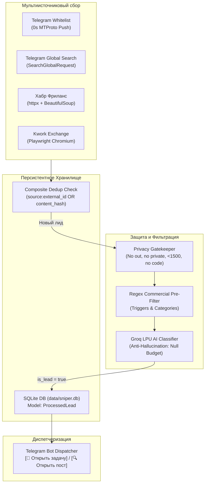

# OmniLeadSniper 🎯 (ранее TgOrderSniper)

**Multi-Source Ingestion (Telegram MTProto + Web Scrapers) + SQLite Persistent DB + Groq AI Scoring + Bot API Dispatcher**

Высокопроизводительный асинхронный сервис для мгновенного перехвата, скоринга и интерактивной доставки коммерческих IT-заказов и лидов из Telegram-каналов, глобального поиска Telegram и ведущих веб-бирж фриланса (Хабр Фриланс, Kwork) в закрытую группу команды с нулевой задержкой.

---

## ⚡ Архитектура: OmniLeadSniper



### Ключевые преимущества Фазы 3:
- **Мультиплатформенный охват**: Мониторинг не только Telegram-каналов и глобального поиска, но и ведущих веб-бирж (Хабр Фриланс, Kwork).
- **100% персистентная защита от дубликатов**: SQLite база данных (`data/sniper.db`) сохраняет состояние между перезапусками сервиса. Двойная дедупликация: по `(source, external_id)` и по `content_hash` (SHA-256) предотвращает повторы кросс-постов.
- **Privacy Gatekeeper**: Полный запрет на перехват исходящих сообщений (`out`), личных переписок (`is_private`), сообщений длиннее 1500 символов и маркеров исходного кода / системных промптов.
- **Anti-Hallucination Guard**: Жесткое правило ИИ-анализа — бюджет извлекается ТОЛЬКО при явном наличии суммы и валюты в тексте; при отсутствии возвращается строго `null` (пустая строка).
- **Адаптивные интерактивные кнопки**: Автоматическое определение типа ссылки: `[🔗 Открыть задачу]` для веб-проектов и `[🔍 Открыть пост]` для постов Telegram.

Подробнее о принятых решениях см. в [ADR-003: Архитектурная трансформация OmniLeadSniper](specs/ADR-003-omnilead-persistent-db-and-web-scrapers.md).

---

## 🚀 Быстрый старт

### 1. Требования
- Python 3.10+
- Аккаунт Telegram для Userbot-сессии
- Telegram-бот от [@BotFather](https://t.me/BotFather)

### 2. Установка зависимостей
```bash
# Клонирование / переход в каталог проекта
cd projects/TgOrderSniper

# Создание и активация виртуального окружения
python -m venv .venv
# Windows:
.venv\Scripts\activate
# Linux/macOS:
source .venv/bin/activate

# Установка зависимостей
pip install -r requirements.txt

# Установка браузера Chromium для Playwright-парсинга Kwork
playwright install chromium
```

### 3. Конфигурация окружения (.env)
Скопируйте пример файла конфигурации:
```bash
cp .env.example .env
```

Заполните переменные в `.env`:
```ini
# 1. Telegram MTProto Userbot Client (https://my.telegram.org)
TG_API_ID=1234567
TG_API_HASH=0123456789abcdef0123456789abcdef
TG_SESSION_NAME=order_sniper
# Опционально: StringSession для stateless/Docker развертывания
# TG_STRING_SESSION=

# 2. Telegram Bot API (Dispatcher)
TG_BOT_TOKEN=1234567890:ABCdefGhIJKlmNoPQRsTUVwxyZ
TARGET_CHAT_ID=-1001234567890

# 3. Список отслеживаемых каналов и чатов (через запятую)
CHANNELS_TO_WATCH=@freelance_chat, @python_jobs, -1009876543210

# 4. Настройки кэша дедупликации
DEDUP_CACHE_SIZE=5000
DEDUP_TTL_SECONDS=86400

# 5. Groq AI Classifier settings
GROQ_API_KEY=gsk_your_groq_api_key_here
GROQ_MODEL=openai/gpt-oss-20b
GROQ_FALLBACK_MODEL=openai/gpt-oss-20b
GROQ_REQUEST_DELAY=1.0

# 6. Global Telegram Search settings
SEARCH_INTERVAL_MINUTES=5
SEARCH_QUERIES=срочно заказ, нужен разработчик, требуется парсер, доработка 1с, интеграция api
SEARCH_RATE_LIMIT_DELAY=2.0

# 7. Персистентная база данных SQLite
DB_PATH=data/sniper.db

# 8. Фоновые веб-скраперы (Хабр Фриланс, Kwork)
ENABLE_WEB_SCRAPERS=true
WEB_SCRAPE_INTERVAL_MINUTES=5
```

### 4. Запуск всех компонентов одной командой

**Вариант A — В один клик на Windows (`start.bat`):**
Дважды щелкните по `start.bat` в проводнике Windows или выполните в командной строке:
```cmd
start.bat
```
- Автоматически переключает консоль в UTF-8 (`chcp 65001`);
- Автоматически находит Python (`.venv`, `venv` или системный Python из `PATH`);
- Выполняет pre-flight верификацию и запускает бота и все компоненты;
- При ошибках удерживает окно открытым (`pause`), чтобы текст ошибки не исчез.

**Вариант B — Единый скрипт запуска (`run.py`):**
```bash
python run.py
```
- **Pre-flight проверка**: проверяет наличие `.env`, выводит наглядный баннер с конфигурацией и маскирует токены;
- **Авто-fallback сессий**: если сессия из `TG_SESSION_NAME` (например, `OrderParser.session`) отсутствует на диске, но найдена `custom_session.session`, скрипт автоматически подхватит её и предупредит в логах;
- **Graceful shutdown**: перехватывает `Ctrl+C` и корректно освобождает ресурсы с чистым кодом возврата;
- **Безопасная проверка**: флаг `python run.py --check` выполнит pre-flight верификацию без запуска бесконечного цикла.

---

## 🔑 Инструкция по получению ключей

### 1. Получение `TG_API_ID` и `TG_API_HASH`:
1. Перейдите на официальный портал разработчиков Telegram: [https://my.telegram.org](https://my.telegram.org).
2. Авторизуйтесь под своим номером телефона с кодом из Telegram.
3. Перейдите в раздел **API development tools**.
4. Создайте новое приложение (любое имя и короткий заголовок, платформа `Desktop` или `Other`).
5. Скопируйте поля `api_id` (целое число) и `api_hash` (32-значная hex-строка) в файл `.env`.

### 2. Получение `TG_STRING_SESSION` (для облачного или Docker развертывания):
Для stateless-развертывания без сохранения SQLite `.session` файлов на диске запустите однострочник:
```bash
python -c "from telethon.sync import TelegramClient; from telethon.sessions import StringSession; api_id = int(input('API ID: ')); api_hash = input('API HASH: '); client = TelegramClient(StringSession(), api_id, api_hash); client.start(); print('\nYOUR TG_STRING_SESSION:\n' + client.session.save())"
```
Скопируйте выведенную строку в переменную `TG_STRING_SESSION` в `.env`.

### 3. Получение `TG_BOT_TOKEN` и `TARGET_CHAT_ID`:
1. Напишите боту [@BotFather](https://t.me/BotFather), отправьте команду `/newbot` и сохраните полученный `token`.
2. Создайте закрытую группу или канал для команды, добавьте туда вашего созданного бота.
3. Чтобы узнать ID чата (`TARGET_CHAT_ID`), перешлите любое сообщение из группы боту [@userinfobot](https://t.me/userinfobot) или [@JsonDumpBot](https://t.me/JsonDumpBot) (для супергрупп ID обычно начинается с `-100...`).

---

## 🛠 Запуск и тестирование

### Запуск сервиса
```bash
# Рекомендуемый способ (единый скрипт с pre-flight проверкой и детекцией сессий):
python run.py

# На Windows (в один клик через батник):
start.bat

# Прямой запуск модуля (альтернативный):
python -m backend.main
```

### Запуск модульных тестов
```bash
pytest -v
```

### Проверка стиля и линтера (Ruff)
```bash
ruff check .
```

---

## 📂 Структура проекта

```
TgOrderSniper/
├── backend/
│   ├── bot/
│   │   ├── __init__.py
│   │   └── dispatcher.py      # HTTPX асинхронный диспетчер Telegram Bot API
│   ├── core/
│   │   ├── __init__.py
│   │   ├── config.py          # Pydantic Settings конфигурация
│   │   └── dedup.py           # LRU + TTL дедупликация (ID + text hash)
│   ├── db/
│   │   ├── __init__.py
│   │   ├── database.py        # SQLite async aiosqlite + SQLAlchemy сессии
│   │   └── models.py          # ORM модель ProcessedLead
│   ├── filter/
│   │   ├── __init__.py
│   │   ├── engine.py          # Strict Gatekeeper, коммерческие триггеры, бюджет
│   │   └── groq_analyzer.py   # AI классификатор, Anti-Hallucination Guard (Groq API)
│   ├── listener/
│   │   ├── __init__.py
│   │   ├── client.py          # Telethon MTProto event-driven клиент + Privacy Gatekeeper
│   │   └── global_search.py   # Фоновый движок глобального поиска Telegram
│   ├── scrapers/
│   │   ├── __init__.py
│   │   ├── base.py            # RawTask pydantic модель и BaseScraper ABC
│   │   ├── habr_freelance.py  # Скрапер Хабр Фриланс (httpx + BeautifulSoup)
│   │   ├── kwork_playwright.py# Скрапер Kwork (Playwright Headless Chromium)
│   │   └── scheduler.py       # Фоновый планировщик скраперов
│   ├── __init__.py
│   └── main.py                # Пайплайн обработки, SQLite дедуп и graceful shutdown
├── specs/
│   ├── ADR-001-hybrid-mtproto-bot-architecture.md
│   ├── ADR-002-groq-ai-scoring-and-global-search.md
│   ├── ADR-003-omnilead-persistent-db-and-web-scrapers.md
│   └── spec.md
├── tests/
│   ├── test_config.py
│   ├── test_db.py             # Тесты SQLite схемы, сохранения и дедупликации
│   ├── test_dedup.py
│   ├── test_dispatcher.py     # Тесты карточек, кнопок, пайплайна и веб-задач
│   ├── test_filter.py
│   ├── test_global_search.py  # Тесты фонового поиска
│   ├── test_groq_analyzer.py  # Тесты AI анализатора и Anti-Hallucination Guard
│   ├── test_listener.py       # Тесты сессий, URL и Privacy Gatekeeper
│   ├── test_run.py            # Тесты pre-flight проверки и точек запуска
│   └── test_scrapers.py       # Тесты Хабр, Kwork скраперов и планировщика
├── .env.example
├── README.md
├── requirements.txt
├── run.py                     # Единая точка запуска с pre-flight проверкой и fallback сессий
├── start.bat                  # Windows батник запуска в 1 клик с автодетектом Python
├── sync.sh                    # Git синхронизация проекта
└── tg_order_sniper_spec.md    # Трекер выполнения этапов
```

---

## 📜 Лицензия
Внутренний проект BestStart / TgOrderSniper. Все права защищены.
