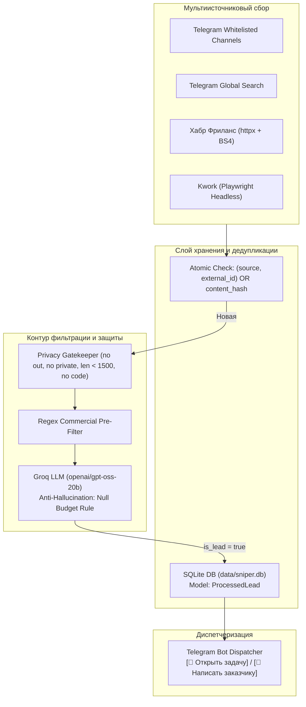

# ADR-003: Архитектурная трансформация TgOrderSniper ➔ OmniLeadSniper (SQLite Persistent DB, Playwright Web Scrapers, Anti-Hallucination Guard)

**Дата**: 2026-10-12  
**Статус**: Принято (Accepted)  
**Авторы / Участники**: Core Backend Team, AI Systems Architect, Security & Scraping Leads  
**Технический домен**: Multi-Source Ingestion, Persistent Storage, Web Scraping, Privacy & Anti-Hallucination  

---

## Контекст и проблематика

В Фазе 2 система **TgOrderSniper** была оснащена глобальным поиском через `SearchGlobalRequest` и скорингом через Groq API. В ходе практической эксплуатации на реальных диалогах и коммерческих заказах были выявлены следующие архитектурные ограничения:

1. **Потеря состояния дедупликации при перезапусках**:
   - Временный in-memory LRU-кэш сбрасывался при каждом перезапуске сервиса, вызывая повторную обработку и дублирование уведомлений в группе.
2. **Угроза приватности (Privacy Leak)**:
   - MTProto Listener слушал все события пользователя, включая исходящие сообщения (`event.message.out`), личные переписки (`event.is_private`) и служебные чаты.
3. **Галлюцинации LLM относительно бюджетов**:
   - При отсутствии точной суммы в тексте модель Groq склонна «додумывать» или предполагать средний рыночный бюджет задачи.
4. **Ограниченность экосистемы только платформой Telegram**:
   - Существенная доля заказов в СНГ публикуется на веб-биржах фриланса (Хабр Фриланс, Kwork). Без веб-скрапинга система упускает до 50% высокочековых задач.

---

## Архитектурное решение

Принято решение о трансформации системы в мультиисточниковый сниппер лидов **OmniLeadSniper**:



### 1. Персистентная база данных SQLite (`backend/db/`)
- Файл базы данных: `data/sniper.db` (автоматическое создание директории и схемы при старте).
- ORM / Async Driver: `SQLAlchemy 2.0` + `aiosqlite`.
- Модель `ProcessedLead`:
  - `id`: Первичный ключ.
  - `source`: Источник (например, `telegram:@job1c`, `web:habr_freelance`, `web:kwork`).
  - `external_id`: ID сущности в источнике.
  - `content_hash`: SHA-256 хеш нормализованного текста (отсекает кросспосты на разных биржах).
  - `title`, `raw_text`, `summary`, `budget`, `tech_stack`, `url`, `is_lead`, `created_at`.
- Метод `is_already_processed(source, external_id, content_hash)` исключает повторную отправку даже после перезапуска сервиса.

### 2. Privacy Gatekeeper & Anti-Hallucination Guard
- **Telegram Privacy Gatekeeper (`backend/listener/client.py`)**:
  - `if event.message.out: return` — полный запрет на чтение исходящих сообщений.
  - `if event.is_private: return` — полный запрет на чтение личных сообщений и Избранного.
  - Длина текста > 1500 символов или маркеры кода (`def `, `class `, ````, `Ты — автономный`) отсекаются немедленно.
  - Слушаются строго каналы из белого списка `CHANNELS_TO_WATCH`.
- **Anti-Hallucination Guard (`backend/filter/groq_analyzer.py`)**:
  - Жесткое системное правило: бюджет извлекается ТОЛЬКО при явном указании суммы и валюты. Если точной суммы нет — возвращать строго `null`.
  - Статьи, новости, вакансии в офис 5/2 и резюме классифицируются как `is_lead: false`.

### 3. Модульный веб-скрапинг (`backend/scrapers/`)
- `BaseScraper` и сущность `RawTask`.
- **Habr Freelance Scraper**: HTTP-клиент на `httpx` + парсинг DOM через `BeautifulSoup` (`https://freelance.habr.com/tasks`).
- **Kwork Scraper**: Headless Chromium через `playwright.async_api` (`https://kwork.ru/projects`) с обходом JS-рендеринга и динамической подгрузки.
- **WebScraperScheduler**: периодический опрос каждые `WEB_SCRAPE_INTERVAL_MINUTES` с отправкой задач в общий конвейер.

---

## Последствия и преимущества

1. **100% защита от дубликатов**: Перезапуск сервиса или сервера не приведет к повторным алертам благодаря персистентному SHA-256 и составным индексам в SQLite.
2. **Абсолютная безопасность личной переписки**: Исключена любая возможность отправки личных сообщений пользователя в ИИ или целевую группу.
3. **Чистые данные без галлюцинаций**: Бюджет отображается только тогда, когда он реально указан заказчиком.
4. **Мультиплатформенный охват**: Сервис трансформирован из узкого Telegram-парсера в полноценный агрегатор лидов со всех ведущих фриланс-площадок.
