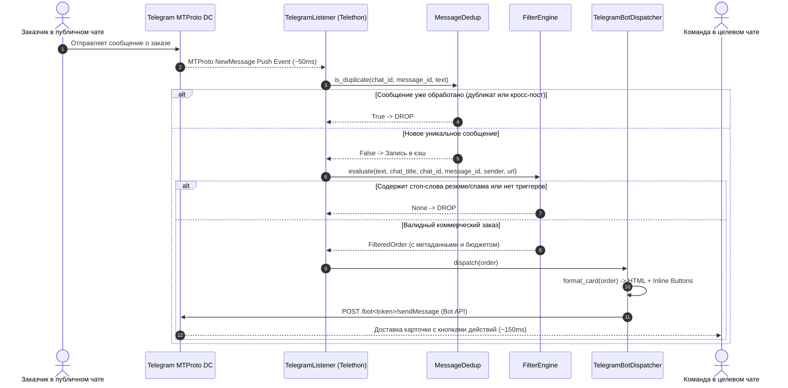

# TgOrderSniper — Функциональная спецификация & Системный дизайн

**Версия**: 1.0.0  
**Статус**: Production Ready (Все этапы 1–4 завершены)  
**Архитектурный стандарт**: Spec-Kit Architecture Blueprint  
**Дата утверждения**: 2026-10-12  
**Основной стек**: Python 3.10+, Telethon MTProto, Httpx (Async HTTP), Pydantic Settings v2, Pytest  

---

## 1. Обзор системы и цели продукта

**TgOrderSniper** — это высокопроизводительная асинхронная event-driven система реального времени, предназначенная для мгновенного перехвата, интеллектуальной фильтрации и интерактивной доставки коммерческих заказов и лидов из сотен публичных и приватных Telegram-каналов и групп в закрытый рабочий чат команды отклика.

### Главные бизнес-цели:
1. **0 секунд задержки (Latency Advantage)**: Перехват заказа в момент публикации на серверах Telegram и доставка карточки в чат команды за < 500 миллисекунд, обеспечивая "first response" преимущество перед конкурентами.
2. **Отсев информационного шума (> 95%)**: Исключение резюме соискателей, спама, рекламы, инфоцыганства и криптовалютных схем с помощью строгого Negative Gatekeeper.
3. **Высокая конверсия отклика (Instant UX Action)**: Каждая карточка формируется с готовыми inline-кнопками для мгновенного перехода к оригинальному посту или открытия прямого диалога с заказчиком в 1 клик.
4. **Антибан-устойчивость (Zero-ban risk)**: Разделение ролей Userbot (read-only listener) и Bot API (активный диспетчер) предотвращает FloodWait и блокировки Telegram-аккаунтов.

---

## 2. Пользовательские истории (User Stories)

### US-1: Мгновенное получение горячих заказов
> **Как** backend/fullstack разработчик или студия,  
> **Я хочу** получать уведомления о новых заказах по моему стеку технологий (Python, боты, парсеры, 1С, API) в течение доли секунды после публикации,  
> **Чтобы** написать клиенту первым и закрыть сделку с высокой конверсией.

### US-2: Чистая лента без спама и резюме
> **Как** тимлид или менеджер команды,  
> **Я хочу**, чтобы система автоматически фильтровала соискателей работы ("ищу работу", "junior", "моё портфолио"), казино, крипто-сигналы и курсы,  
> **Чтобы** команда не тратила драгоценное время на чтение нерелевантного контента.

### US-3: Извлечение бюджета и метаданных
> **Как** специалист по оценке задач,  
> **Я хочу** сразу видеть выделенный бюджет (в рублях, долларах, евро или валюте СНГ), автора заказа и теги категорий,  
> **Чтобы** мгновенно квалифицировать лид по финансовой привлекательности.

### US-4: Интерактивный отклик в один клик
> **Как** дежурный инженер,  
> **Я хочу** кликнуть по кнопке `[💬 Написать заказчику]` или `[🔍 Открыть пост]` прямо под сообщением в рабочей группе,  
> **Чтобы** не копировать юзернеймы вручную и не тратить время на поиск автора.

---

## 3. Архитектура и поток данных

### 3.1. Архитектурная схема компонентов

```mermaid
flowchart TD
    subgraph Telegram_Network["Сеть Telegram"]
        MonitoredChannels["Мониторимые каналы и чаты\n(Freelance, IT Orders, Chats)"]
        TargetChat["Целевая закрытая группа\n(Команда отклика)"]
    end

    subgraph TgOrderSniper_Daemon["TgOrderSniper Сервис"]
        subgraph Listener_Module["1. MTProto Listener Core"]
            TelethonClient["Telethon MTProto Client\n(TCP Session / Push Events)"]
            EventBus["events.NewMessage Stream"]
        end

        subgraph Guard_Module["2. Deduplication Guard"]
            DedupCache["MessageDedup (LRU + TTL)\nKey: msg:{chat_id}:{msg_id}\nHash: SHA-256(normalized_text)"]
        end

        subgraph Filter_Module["3. Rule-Based Filter Engine"]
            Cutoff["3.1 Length Cutoff (< 15 символов)"]
            NegGate["3.2 Strict Negative Gatekeeper\n(Резюме, Спам, Казино, Крипта)"]
            PosMatch["3.3 Positive Commercial Matcher\n(Коммерческий спрос: срочно, нужен...)"]
            MetaParser["3.4 Metadata & Budget Extractor\n(Валюты, категории, авторы)"]
        end

        subgraph Dispatcher_Module["4. Bot API Dispatcher"]
            CardFormatter["Card Formatter\n(HTML Escape, Highlights, Buttons)"]
            AsyncHTTP["httpx.AsyncClient\n(Retry-After 429, Backoff)"]
        end
    end

    MonitoredChannels -->|MTProto Push Stream| TelethonClient
    TelethonClient --> EventBus
    EventBus --> DedupCache
    DedupCache -->|Новое сообщение| Cutoff
    Cutoff -->|Длина >= 15| NegGate
    NegGate -->|Нет стоп-слов| PosMatch
    PosMatch -->|Найдены триггеры| MetaParser
    MetaParser --> CardFormatter
    CardFormatter --> AsyncHTTP
    AsyncHTTP -->|POST sendMessage (Bot API)| TargetChat
```

### 3.2. Диаграмма последовательности обработки (Sequence Diagram)



---

## 4. Матрица фильтрации & Нормализация

Движок фильтрации `FilterEngine` осуществляет детерминированную многоуровневую селекцию:

| Фаза | Назначение | Критерий и правила | Поведение системы |
|---|---|---|---|
| **Phase 0: Length Cutoff** | Отсечение шума и смайлов | `len(text.strip()) < 15` | Мгновенный DROP без regex-анализа |
| **Phase 1: Resume Gatekeeper** | Отсев соискателей и junior специалистов | 29 фраз: `ищу работу`, `обо мне`, `мои навыки`, `резюме`, `портфолио`, `junior`, `в поисках работы` и др. | Мгновенный DROP |
| **Phase 2: Spam & Scam Gatekeeper** | Отсев финансового и рекламного мусора | 22 паттерна: `крипта`, `сигналы`, `1win`, `казино`, `пассивный доход`, `заработок от`, `слив курсов` и др. | Мгновенный DROP |
| **Phase 3: Positive Commercial Demand** | Подтверждение намерения заказать разработку | 27 словоформ: `срочно`, `заказ`, `требуется`, `нужен`, `ищем разработчика`, `доработать`, `под ключ`, `тз` и др. | Обязательное совпадение хотя бы одного триггера |
| **Phase 4: Tech & Domain Tagging** | Категоризация заказа | Паттерны категорий: `телеграм бот`, `парсер`, `скрипт`, `1с`, `python` | Назначение хэштегов `#телеграм_бот`, `#парсер` |
| **Phase 5: Budget Extractor** | Извлечение коммерческих условий | Регулярные выражения цен с валютами (`руб`, `р`, `₽`, `$`, `usd`, `€`, `тг`, `к`) | Нормализация в поле `detected_budget` |

---

## 5. Спецификация Карточки Заказа и Inline-кнопок

### 5.1. Шаблон разметки сообщения (HTML)
```html
🔥 <b>НОВЫЙ ЗАКАЗ</b>
📍 <b>Источник:</b> {escaped_chat_title}
🏷️ <b>Категории:</b> #{tag1} #{tag2}
💰 Бюджет: <b>{escaped_budget}</b>
👤 <b>Автор:</b> @{username} | <a href="tg://user?id={id}">{name}</a>

📝 <b>Задача:</b>
{escaped_and_highlighted_text}
```

### 5.2. Правила обработки текста и безопасности
1. **Экранирование спецсимволов**: Все пользовательские поля (`chat_title`, `text`, `author_name`, `author_username`) экранируются через `html.escape(..., quote=True)` во избежание HTML-инъекций.
2. **Лимит длины**: Текст задачи обрезается до 1500 символов с добавлением многоточия `...`.
3. **Подсветка триггеров**: Найденные положительные триггеры спроса выделяются тегами `<b>...</b>`.
4. **Интерактивные кнопки**:
   - `[🔍 Открыть пост]`: открывает исходный пост по прямой ссылке (`https://t.me/...` или `https://t.me/c/...`).
   - `[💬 Написать заказчику]`: ведет напрямую в диалог с заказчиком (`https://t.me/{username}` или `tg://user?id={id}`).

---

## 6. Нефункциональные требования (NFR)

1. **Задержка обработки (Latency)**: Менее 500 мс от момента события в Telegram до отправки сообщения в целевой чат.
2. **Отказоустойчивость**:
   - При разрыве TCP-соединения Telethon выполняет автоматический реконнект без потери состояния.
   - При получении HTTP 429 от Telegram Bot API диспетчер читает параметр `retry_after` и выполняет повторную отправку.
   - При сетевых сбоях используется экспоненциальный backoff до 3 попыток.
3. **Безопасность сессии**: Поддержка `StringSession` позволяет запускать систему в контейнерах и stateless-окружениях без сохранения локальных SQLite `.session` файлов.
4. **Дедупликация**: In-memory буфер с двойным ключом (координаты `chat_id:message_id` + SHA-256 хеш нормализованного текста) предотвращает дублирование пересылаемых постов.
