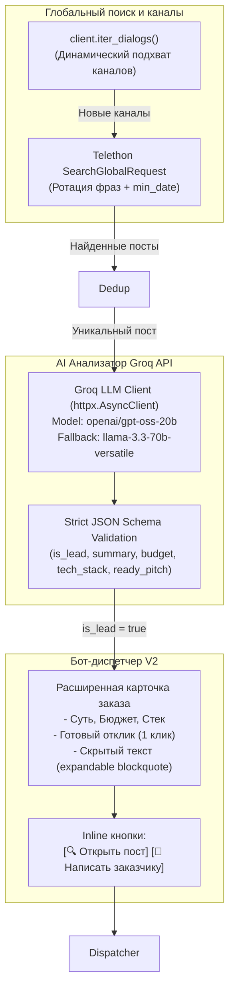

# TgOrderSniper — Техническая спецификация & Архитектурный трекер

**Версия**: 1.0.0 | **Архитектурный стандарт**: Spec-Kit Architecture Blueprint | **Дата**: 2026-10-12  
**Тип системы**: Event-driven MTProto Listener + Real-time Filter + Bot API Dispatcher  
**Стек**: Python 3.10+, Telethon (MTProto), Httpx (Telegram Bot API), Pydantic-Settings v2, Pytest  

---

## 1. Архитектура: MTProto Listener + Fast Filter + Bot Dispatcher

```mermaid
flowchart TD
    subgraph Telegram_Ecosystem["Экосистема Telegram"]
        Channels["Отслеживаемые каналы / группы (Freelance, IT, Orders)"]
        TargetGroup["Закрытая целевая группа (Команда отклика)"]
    end

    subgraph TgOrderSniper["Сервис TgOrderSniper"]
        subgraph Listener_Core["MTProto Listener Core"]
            Client["Telethon MTProto Client\n(Userbot session, Auto-reconnect)"]
            EventBus["events.NewMessage(chats=...)"]
        end

        subgraph Guard_Deduplication["Кэш и Дедупликация"]
            Dedup["Dedup Buffer\n(LRU/TTL cache: chat_id:msg_id)"]
        end

        subgraph Rule_Engine["Движок фильтрации & Нормализации"]
            NegGate["1. Strict Negative Gatekeeper\n(Резюме, Спам, Реклама)"]
            PosMatch["2. Positive Trigger Matcher\n(Коммерческий спрос, Срочность)"]
            MetaExtract["3. Metadata & Budget Extractor\n(Regex валют, автор, deep-links)"]
        end

        subgraph Dispatcher_Core["Бот-диспетчер"]
            Dispatcher["Telegram Bot Dispatcher\n(Async HTTP via httpx)"]
            CardFormatter["Card Formatter\n(HTML-разметка, подсветка, inline-кнопки)"]
        end
    end

    Channels -->|MTProto Real-Time Stream (0s latency)| Client
    Client --> EventBus
    EventBus --> Dedup
    Dedup -->|Новое сообщение| NegGate
    NegGate -->|Прошло стоп-слова| PosMatch
    PosMatch -->|Найдены триггеры заказа| MetaExtract
    MetaExtract --> CardFormatter
    CardFormatter --> Dispatcher
    Dispatcher -->|Telegram Bot API: sendMessage + Inline Keyboard| TargetGroup
```

### Архитектурные принципы:
1. **0 секунд latency (Event-Driven)**: Отказ от Polling каждые 5-10 минут. Использование долгоживущего TCP/MTProto соединения Telethon с подпиской на push-события Telegram серверов.
2. **Гибридная схема (MTProto + Bot API)**: Userbot используется исключительно на чтение сообщений из публичных/приватных каналов без прав администратора. Доставка в целевую группу осуществляется через Telegram Bot API, что гарантирует работу inline-кнопок со ссылками и deep-link на заказчика.
3. **Строгая изоляция и защита от бана**: Userbot не производит спам-действий, работает только в режиме `read-only listener`, что сводит к нулю вероятность FloodWait и блокировок аккаунта.
4. **Атомарная дедупликация**: LRU/TTL кольцевой буфер сообщений предотвращает повторные алерты при редактировании или повторной пересылке постов.

---

## 2. Матрица фильтрации: Positive Triggers vs Negative Stop-Words

| Категория | Логика валидации | Примеры ключевых паттернов / RegExp |
|---|---|---|
| **Negative Gatekeeper (Резюме / Кандидаты)** | Мгновенный DROP (отсев ~70% шума) | `ищу работу`, `обо мне`, `резюме`, `мои навыки`, `портфолио`, `опыт работы:`, `ищу проект`, `готов работать`, `junior`, `fullstack разработчик ищет` |
| **Negative Gatekeeper (Спам / Реклама / Инфоцыганство)** | Мгновенный DROP (отсев ~25% шума) | `крипта`, `сигналы`, `казино`, `раскрутка`, `пассивный доход`, `заработок от`, `вход в канал`, `подпишись`, `бесплатный вебинар`, `дарю гайд`, `слив курсов` |
| **Positive Commercial Demand (Заказчики / Спрос)** | Обязательный MATCH (хотя бы один триггер) | `срочно`, `заказ`, `требуется`, `нужен`, `ищем разработчика`, `исправить`, `доработать`, `написать`, `разработать`, `сделать`, `под ключ`, `тз`, `техзадание` |
| **Positive Tech Triggers (Стек / Специфика)** | Обогащение категории (тегов) | `парсер`, `скрипт`, `бот`, `telegram bot`, `1с`, `1c`, `python`, `api`, `выгрузка`, `интеграция`, `база данных`, `сайт`, `backend` |
| **Budget Extraction** | Нормализация бюджета | `(\d+[\s\d]*)\s*(?:руб|р|₽|usd|\$|eur|€|тг|kzt|к|k)\b` |

---

## 3. План разработки и чек-лист интеграции

### ЭТАП 1: Реализация асинхронного ядра прослушивания (MTProto Core)
- [x] 1.1. Создать базовую структуру каталогов `projects/TgOrderSniper/backend/` (`listener`, `core`, `filter`, `bot`).
- [x] 1.2. Создать `backend/core/config.py` с валидацией настроек через `pydantic-settings` (`API_ID`, `API_HASH`, `BOT_TOKEN`, `TARGET_CHAT_ID`, `CHANNELS_LIST`, `SESSION_NAME` / `STRING_SESSION`).
- [x] 1.3. Создать `backend/core/dedup.py` с in-memory LRU/TTL кольцевым буфером хешей сообщений (`chat_id:message_id`).
- [x] 1.4. Создать `backend/listener/client.py` на базе `Telethon` с безопасной загрузкой сессии, авто-реконнектом и подпиской `events.NewMessage`.

### ЭТАП 2: Движок фильтрации и нормализации (Rule Engine)
- [x] 2.1. Создать `backend/filter/engine.py` с реализацией `FilterEngine`.
- [x] 2.2. Реализовать Strict Negative Gatekeeper (отсев резюме, крипты, рекламы).
- [x] 2.3. Реализовать Positive Trigger Matching (коммерческий спрос, ключевые слова, стек).
- [x] 2.4. Реализовать парсер метаданных: извлечение автора (`@username`, `user_id`), ссылки на пост (`t.me/...`), названия канала/чата и бюджета.

### ЭТАП 3: Бот-диспетчер и UX интерактивного отклика (Dispatcher)
- [x] 3.1. Создать `backend/bot/dispatcher.py` на базе `httpx.AsyncClient` для прямой отправки сообщений в Telegram Bot API.
- [x] 3.2. Сформировать шаблон карточки с HTML-форматированием, тегами, очищенным текстом задачи и блоком автора.
- [x] 3.3. Реализовать генерацию Inline-кнопок: `[Открыть пост]` (URL-ссылка) и `[Написать заказчику]` (deep-link `tg://user?id=...` или `https://t.me/...`).
- [x] 3.4. Создать `backend/main.py` — точку входа для связывания всех компонентов в единый пайплайн.

### ЭТАП 4: Тестирование, Spec-Kit ADR и финализация
- [x] 4.1. Разработать модульные тесты для `dedup.py`, `engine.py`, `dispatcher.py` и `config.py`.
- [x] 4.2. Добавить спецификации в `specs/` и зафиксировать ADR-001 по гибридной архитектуре MTProto + Bot API.
- [x] 4.3. Создать `.env.example`, `requirements.txt` и `README.md`.
- [x] 4.4. Создать `sync.sh` в `projects/TgOrderSniper` и синхронизировать репозиторий через `./sync.sh`.

---

## 4. Фаза 2: Global Search Poller и Интеллектуальный скоринг через Groq API



### Чек-лист Фазы 2:
- [x] 2.1. Создать ADR: `specs/ADR-002-groq-ai-scoring-and-global-search.md`.
- [x] 2.2. Обновить `backend/core/config.py`, `.env.example`, `.env` (Groq API, модели, параметры поиска).
- [x] 2.3. Реализовать `backend/listener/global_search.py` (ротация запросов, SearchGlobalRequest, min_date, лимиты, dialogs).
- [x] 2.4. Реализовать `backend/filter/groq_analyzer.py` (асинхронный клиент Groq, валидация JSON, промпт классификатора и генератора pitch, фоллбэк на llama-3.3-70b-versatile).
- [x] 2.5. Обновить `backend/bot/dispatcher.py` (расширенная карточка с готовым откликом и expandable blockquote).
- [x] 2.6. Интегрировать компоненты в `backend/main.py`.
- [x] 2.7. Разработать модульные тесты `tests/test_groq_analyzer.py` и `tests/test_global_search.py`.
- [x] 2.8. Прогнать pytest и ruff check, исправить все ошибки.
- [x] 2.9. Зафиксировать изменения и выполнить `./sync.sh`.

